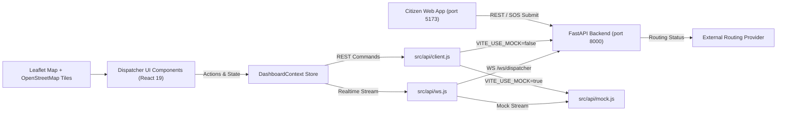

# System Architecture — Urban Crisis & Crowd Evacuation Engine

## 1. High-Level System Diagram

---

## 2. Dispatcher Frontend Module Breakdown (`dispatcher-web/src/`)

| Path | Responsibility |
| --- | --- |
| `src/api/client.js` | Single HTTP boundary for auth, dashboard snapshot, roads, alert decisions, simulation endpoints, and health checks. Handles `401/403` forced logout and `429` rate-limit toast callbacks. |
| `src/api/ws.js` | Realtime transport manager switching between live `WebSocket` and `mock.js` stream. Implements exponential backoff reconnect and triggers full snapshot resync upon reconnection. |
| `src/api/mock.js` | Self-contained Baku crisis fixtures and stateful mock event emitter (`sos.created` every ~4s, `alert.created` after ~15s, plus immediate responses to approvals and simulation commands). |
| `src/auth/permissions.js` | Declarative RBAC map (`can(role, action)`) gating alert decisions and the admin simulation drawer. |
| `src/state/DashboardContext.jsx` & `dashboardStore.js` | Centralized React Context + Reducer holding auth session, normalized crisis entities (`zones`, `sos`, `shelters`, `crews`, `alerts`, `roads`), derived KPI counters, map focus targets, audio mute state, and toast queue. |
| `src/i18n/` | `i18next` setup with complete translations in Azerbaijani (`az.json`, default), English (`en.json`), and Russian (`ru.json`). |
| `src/utils/` | Note sanitization (`sanitize.js`), Web Audio chime (`audio.js`), and localized relative time formatting (`time.js`). |
| `src/pages/` & `src/components/` | Pure presentation & interaction components (`LoginPage`, `DashboardPage`, `Header`, `StatsBar`, `RedAlertBanner`, `SosFeedPanel`, `CrisisMap`, `RightStatusPanel`, `SimulationDrawer`, `ToastContainer`). |

---

## 3. Architectural & Resilience Decisions

### Strict API Boundary Isolation
UI components and pages **never** call `fetch` or `WebSocket` directly. Every network and realtime interaction passes exclusively through `src/api/client.js` and `src/api/ws.js`, ensuring:
- Seamless toggling between offline mock fixtures (`VITE_USE_MOCK=true`) and live backend (`VITE_USE_MOCK=false`).
- Consistent attachment of `Authorization: Bearer <token>` headers.
- Centralized handling of `401`/`403` session expiry and `429` rate limiting.

### Realtime Reconnect & Snapshot Resync
In `src/api/ws.js`:
1. If the WebSocket drops unexpectedly, connection status transitions to `reconnecting` (orange pill in the header).
2. Reconnection uses **exponential backoff** (`1s → 2s → 4s → 8s → max 15s`) to prevent thundering-herd retries against the backend.
3. Upon successful reconnection, `onReconnectResync()` immediately executes `GET /api/dashboard` + `GET /api/roads` + `GET /api/health` so no missed deltas cause stale map markers or incorrect KPI counts.

### Single-Screen Control-Room Ergonomics
The dashboard locks outer layout dimensions to `100vh` with `overflow: hidden`, delegating scrolling strictly to internal feed/status lists (`SosFeedPanel` and `RightStatusPanel`). Both `1920x1080` and `1366x768` viewports keep the header, KPI bar, pulsing Red Alert banner, and interactive Baku map visible simultaneously without page-level vertical scrolling.
