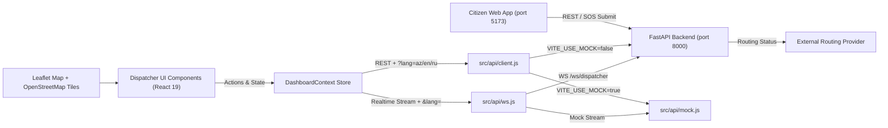

# System Architecture — Urban Crisis & Crowd Evacuation Engine

## 1. High-Level System Diagram

---

## 2. Dispatcher Frontend Module Breakdown (`dispatcher-web/src/`)

| Path | Responsibility |
| --- | --- |
| `src/api/client.js` | Single HTTP boundary for auth, `?lang=`-aware snapshot/roads/health (`{ status, routingProvider, breaker }`) requests, alert decisions, and simulation endpoints (`simSetProvider`, `simCloseRoad`, `simShelterOccupancy`, `simSosBurst`, `simReset`). Parses structured `{"error":{"code","message"}}` responses (`ALERT_NOT_PENDING`, `NO_CREW_AVAILABLE`), handles `401/403` forced logout, and forwards `429 Retry-After` seconds to toast callbacks. |
| `src/api/ws.js` | Realtime transport manager switching between live `WebSocket` (`/ws/dispatcher?token=...&lang=...`) and `mock.js` stream. Implements exponential backoff reconnect (`1s → 15s`), full snapshot resync on reconnect, and clean session termination on WS close code `1008`. |
| `src/api/mock.js` | Baku crisis fixtures and stateful mock event emitter supporting Drop 1 `special_needs` priority SOS items, `accessible` shelters/roads, `accessibleTransport` crews, `PRIORITY_SOS` alerts, and stateful `routingProvider` / `breaker` simulation (`mockSimSetProvider` emitting `provider.updated`). |
| `src/auth/permissions.js` | Declarative RBAC map (`can(role, action)`) aligned with `backend/app/auth.py`, gating alert decisions and the simulation drawer (`simulate` enabled for both `dispatcher` and `admin`). |
| `src/state/DashboardContext.jsx` & `dashboardStore.js` | Centralized React Context + Reducer holding auth session, priority-sorted SOS list, normalized crisis entities (`zones`, `sos`, `shelters`, `crews`, `alerts`, `roads`), `routingProvider` (`up` / `down` / `slow`) & `routingBreaker` (`closed` / `open`), derived KPI counters (including `prioritySos`), `priorityOnlyFilter`, map focus targets, audio mute state, and toast queue. |
| `src/i18n/` | Dynamic `i18next` setup synchronizing `<html lang="...">` and `sessionStorage` across Azerbaijani (`az.json`, default), English (`en.json`), and Russian (`ru.json`). |
| `src/utils/` | Note sanitization (`sanitize.js`), Web Audio chime (`audio.js`), and locale-aware number/time formatting (`time.js`). |
| `src/pages/` & `src/components/` | Presentation and interaction components (`LoginPage`, `DashboardPage`, `Header`, `StatsBar`, `RedAlertBanner`, `SosFeedPanel`, `CrisisMap`, `RightStatusPanel`, `SimulationDrawer`, `ToastContainer`). |

---

## 3. Architectural & Resilience Decisions

### Strict API Boundary Isolation & Contract Alignment
UI components and pages **never** call `fetch` or `WebSocket` directly. Every network and realtime interaction passes exclusively through `src/api/client.js` and `src/api/ws.js`, ensuring:
- Seamless toggling between offline mock fixtures (`VITE_USE_MOCK=true`) and live backend (`VITE_USE_MOCK=false`).
- Consistent attachment of `Authorization: Bearer <token>` headers and `?lang=` locale query parameters.
- Centralized handling of `401`/`403`, WS close code `1008`, `409` conflict codes (`ALERT_NOT_PENDING`, `NO_CREW_AVAILABLE`), and `429` (`Retry-After`).

### Priority SOS Ordering & Accessibility Visibility
- **Client-Side Guarantee:** Both snapshot hydration and incremental `sos.created` / `sos.updated` WebSocket frames pass through `sortSosByPriorityAndTime()`, guaranteeing `priorityRank === 1` (`special_needs`) signals stay pinned above standard (`priorityRank === 2`) signals regardless of network arrival order.
- **Accessibility Overlays:** `accessible` flags on shelters and roads and `accessibleTransport` flags on crews surface simultaneously in `RightStatusPanel`, `CrisisMap` markers/popups/tooltips, and `RedAlertBanner` dispatch proposals (`newShelterId: null` supported natively).

### Realtime Reconnect & Snapshot Resync
In `src/api/ws.js`:
1. If the WebSocket closes with code `1008` (invalid/expired token or unauthorized role), reconnection stops immediately, `sessionStorage` is cleared, and the UI returns cleanly to `LoginPage`.
2. For transient disconnects, connection status transitions to `reconnecting` and retries with **exponential backoff** (`1s → 2s → 4s → 8s → max 15s`).
3. Upon successful reconnection, `onReconnectResync()` executes `GET /api/dashboard`, `GET /api/roads`, and `GET /api/health` so no missed events leave stale state.

---

## 4. Routing Provider & Circuit Breaker Architecture (Section J)

1. `DashboardContext` initializes `routingProvider` (`up` | `down` | `slow`) and `routingBreaker` (`closed` | `open`) from `GET /api/health` on load and on reconnect.
2. When an operator triggers `Up` / `Slow` / `Down` in `SimulationDrawer.jsx` (`POST /api/sim/provider`) or when the backend trips `CircuitBreaker(threshold=3, cooldown=30.0)` over `2.0s` upstream timeouts (`MockProvider` or `OsrmProvider`), the backend broadcasts `provider.updated` (`{ state, breaker }`) over `/ws/dispatcher`.
3. `Header.jsx` renders the severity-coded status pill (`UP` green, `SLOW` amber, `DOWN` red) alongside the breaker tag (`closed` / `open`) immediately without reload while routing endpoints automatically degrade to Haversine `"fallback"` routes when open/down.
